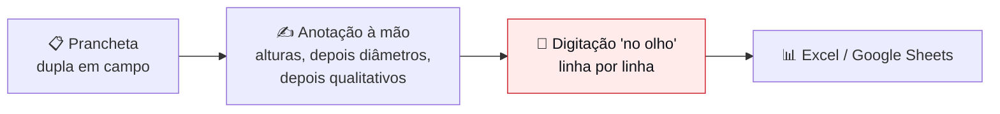
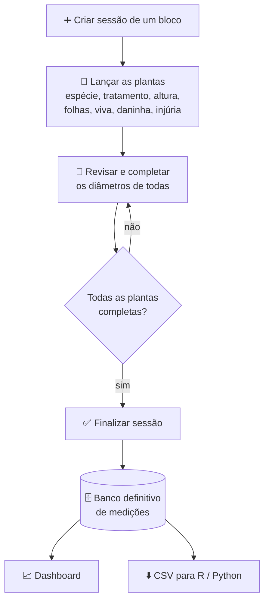
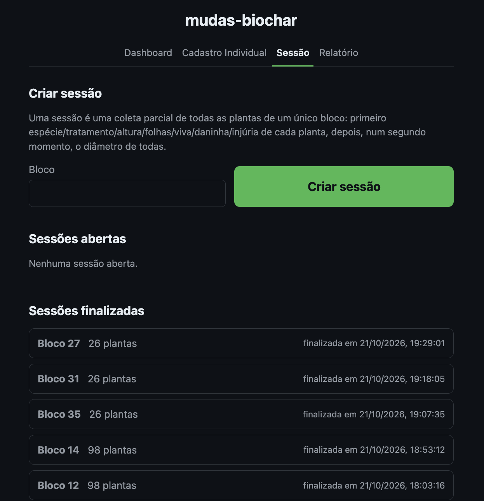
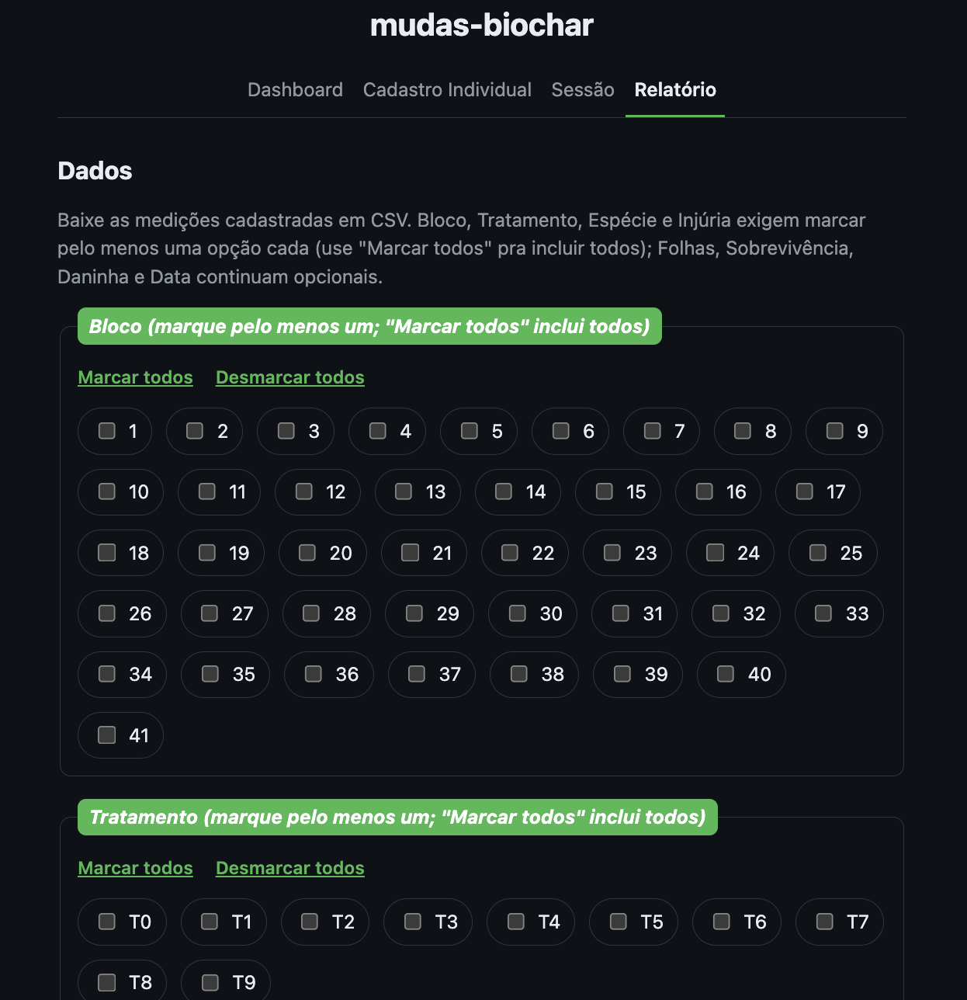
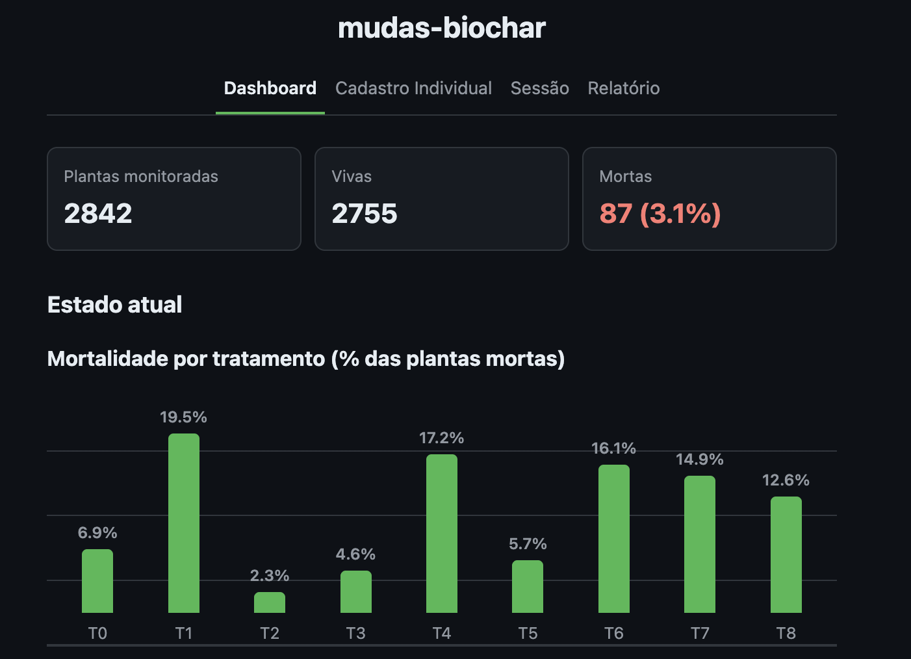
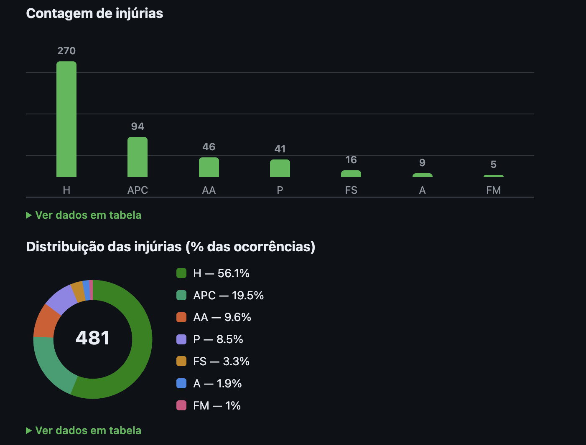
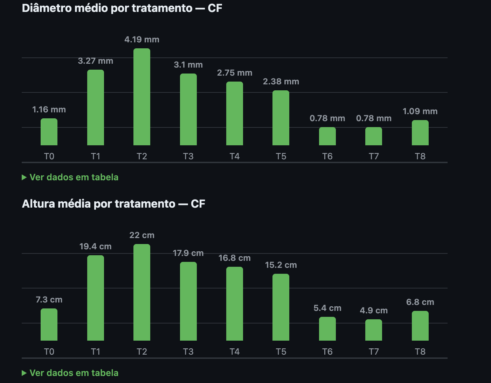
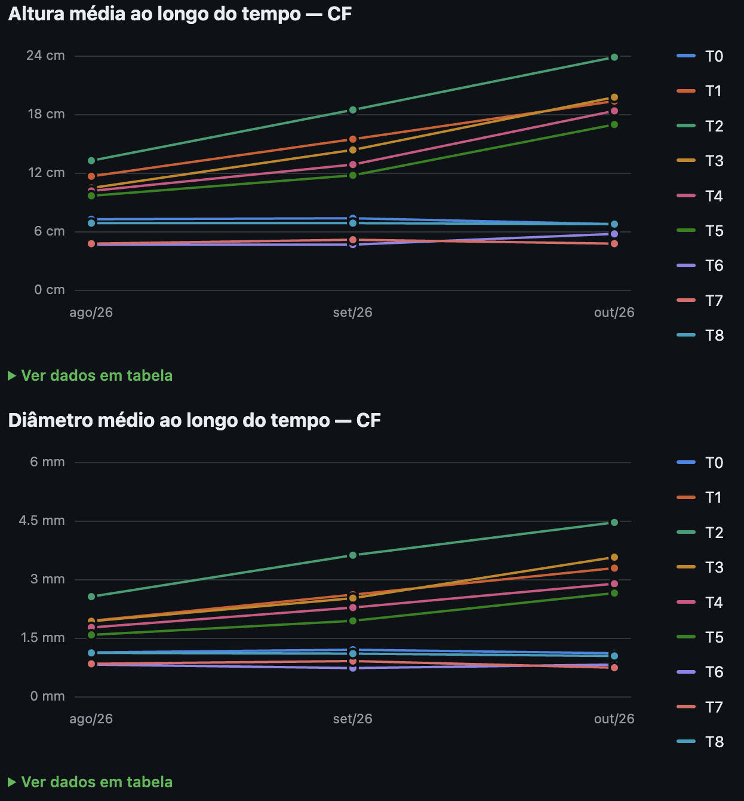
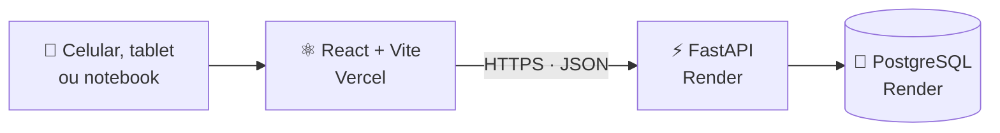

<div align="center">


# mudas-biochar

**Do papel ao dashboard: coleta e acompanhamento de dados de uma pesquisa sobre biochar e o crescimento de plantas.**

</div>

<br />

## 🌱 Contexto da pesquisa

O **Leo** está conduzindo uma pesquisa sobre a **influência do biochar na saúde e no crescimento de plantas**. O experimento compara **13 espécies** sob **9 tratamentos** (T0 a T8), distribuídas em **blocos** — cada bloco é um conjunto de espécies diferentes, com tratamentos diferentes.

A pesquisa tem duas macro-etapas, e cada uma tem um fluxo de trabalho muito próprio:

1. **Experimento / coleta de dados** — medir e observar as plantas, bloco a bloco, ao longo do tempo;
2. **Análise dos dados** — trabalhar o que foi coletado (R, Python e afins).

O app nasceu para resolver a primeira etapa.

## 📋 Como a coleta funcionava antes do app

- A coleta era sempre feita em **dupla**: uma pessoa com a **prancheta**, a outra com os **equipamentos de medição**.
- A dupla passava por um bloco em "ondas": **todas as alturas → todos os diâmetros → as propriedades qualitativas** (viva ou morta, daninha, folhas...). Esse foi o jeito mais eficiente que a pesquisa encontrou, porque assim o tempo perdido **trocando de ferramenta** fica mínimo — uma percepção anterior ao app.
- A prancheta permitia que **várias duplas coletassem ao mesmo tempo**, sem interferência nem atropelo de trabalho.
- Depois, a dupla passava as anotações para uma planilha (Excel, salva no Google Sheets) **linha por linha, no olho**.



## ⚠️ Onde esse método quebrava

- **Erro ao anotar** — um valor errado, ou perder qual espécie, bloco ou tratamento estava sendo medido naquele momento.
- **Erro ao copiar** — na hora de passar os dados da prancheta para a planilha.
- **Linhas confundidas** — além de gerar dados incoerentes, aumentam muito o tempo gasto por linha.
- **Tempo gigantesco** — estamos falando de **mais de 10 mil linhas** coletadas numa prancheta e depois escritas à mão, no olho, numa planilha.

## 🎯 A tarefa

Fazer um app para **anotar o dado na hora da coleta**: o tempo de passar para o Excel vai a **zero**, e o app ajuda a evitar erros de digitação inconsistentes.

## 💡 O desafio: coletar por "ondas", não por planta

Um **cadastro individual** (uma planta por vez) não resolve. Como vimos, o eficiente é medir **todas as alturas e só depois todos os diâmetros**; o cadastro individual obrigaria a fazer a medição completa da planta na hora, trazendo de volta a troca constante de ferramenta e inviabilizando a solução.

A saída foi criar um banco de dados **parcial**, correspondente a uma **sessão** de medidas: o usuário lança todas as alturas de um bloco e depois só passa preenchendo os diâmetros (ou o contrário). Quando a sessão está completa, ela sobe para o **banco de dados definitivo**, com todas as medidas já feitas.



**Regras da sessão** (garantidas pela API):

- só pode haver **uma sessão aberta por bloco**;
- cada combinação **espécie + tratamento** entra **uma vez** por sessão;
- a sessão só pode ser finalizada com **todas as plantas completas** (altura e diâmetro preenchidos);
- ao finalizar, cada planta vira uma medição definitiva com a **hora em que foi lançada** (não a da finalização), e a sessão passa a ser histórico — não pode mais ser alterada nem removida.

## 📱 O que foi construído

O layout foi pensado primeiro para **celular e tablet na vertical**, que é onde a coleta acontece. O app tem cinco áreas.

> Os prints abaixo servem apenas para demonstrar a interface do app.

### 1. Sessões — a coleta eficiente

Cria-se uma sessão informando o **bloco**. Dentro dela, **Nova planta** registra espécie, tratamento, altura, diâmetro(s), folhas, viva, daninha, injúrias e observação — e a planta pode ser salva **incompleta**. Depois, **Revisar plantas** percorre uma a uma (*Salvar e próxima*) para completar o que falta, e **Finalizar sessão** envia tudo para o banco definitivo.

<p align="center">
  
</p>

### 2. Cadastro individual

O mesmo registro, mas **uma medição completa por vez**, direto no banco definitivo. É pouco usado, mas útil em casos pontuais — por exemplo, uma planta medida fora da passada normal. A data da medição é preenchida automaticamente.

### 3. Tabela de medições — achar e corrigir um dado

A tabela do banco definitivo, direto na tela, das medições **mais recentes para as mais antigas** e em páginas de 50 linhas. Os filtros no topo (**bloco**, **espécie** e **tratamento**) servem para chegar a uma medição específica. Cada linha tem uma **lixeira vermelha**: ao clicar, um pequeno modal pede a confirmação (**Tenho certeza** / **Cancelar**) antes de excluir aquela medição. A exclusão é definitiva — por isso a confirmação.

### 4. Relatório — CSV para análise externa

Baixa o banco definitivo em **CSV**, pronto para ferramentas externas (**R**, **Python**...). Dá para filtrar por **bloco**, **tratamento**, **espécie** e **injúria** (inclusive "sem nenhuma injúria"), além de folhas, sobrevivência, daninha e data. O arquivo é gerado com codificação que o **Excel** abre sem quebrar os acentos.

<p align="center">
  
</p>

### 5. Dashboard — acompanhar o experimento ao vivo

O dashboard foi uma iniciativa extra do desenvolvimento, para que o Leo pudesse **acompanhar os dados de forma ativa ao longo do experimento**, sem esperar a fase de análise.

- **Estado atual** — cada planta conta pela sua **medição mais recente** (se a última medição é "morta", ela conta como morta, mesmo que as anteriores estivessem vivas): cartões-resumo, mortalidade por tratamento e por bloco, contagem e distribuição das injúrias, e altura e diâmetro médios por tratamento para a espécie e o período escolhidos.
- **Evolução ao longo do tempo** — altura média, diâmetro médio e mortalidade acumulada, mês a mês, **por espécie** (uma linha por tratamento), **por tratamento** e **por bloco** (em cada gráfico, os blocos de menor, 25%, mediana, 75% e maior valor **atual** em destaque, e os demais em cinza). A mortalidade acumulada usa o eixo de 0 a 25%, que cresce sozinho se algum dado passar disso.

Os gráficos são desenhados em SVG/HTML puro, têm tema claro e escuro, cores conferidas para daltonismo e uma tabela de dados em cada um (*Ver dados em tabela*).

<table>
  <tr>
    <td align="center" valign="top"></td>
    <td align="center" valign="top"></td>
  </tr>
  <tr>
    <td align="center"><sub>Cartões-resumo e mortalidade por tratamento</sub></td>
    <td align="center"><sub>Contagem e distribuição das injúrias</sub></td>
  </tr>
  <tr>
    <td align="center" valign="top"></td>
    <td align="center" valign="top"></td>
  </tr>
  <tr>
    <td align="center"><sub>Médias por tratamento, para uma espécie</sub></td>
    <td align="center"><sub>Evolução no tempo, uma linha por tratamento</sub></td>
  </tr>
</table>

## 🧬 O dado

Cada linha do banco definitivo é **uma medição de uma planta** em um momento. Uma planta é identificada por **bloco + espécie + tratamento** e é medida várias vezes ao longo do tempo — cada lançamento é uma medição nova, nunca uma edição da anterior.

| Campo | Tipo | Observações |
| --- | --- | --- |
| **Bloco** | inteiro | identifica o bloco da planta |
| **Espécie** | lista | `CF` `CV` `CS` `ED` `ES` `MB` `MC` `MF` `MH` `MG` `JP` `ST` `SG` |
| **Tratamento** | lista | `T0` a `T8` |
| **Altura** | decimal (1 casa), opcional | em cm |
| **Diâmetro 1** | decimal (2 casas), opcional | em mm |
| **Diâmetro 2** | decimal (2 casas), opcional | só para caule quadrado (2 medidas); caule redondo deixa vazio |
| **Folhas** | sim / não | tem ou não tem folhas |
| **Sobrevivência** | viva / morta | |
| **Daninha** | sim / não | tem ou não tem daninha |
| **Injúria** | múltipla escolha, opcional | `A` `AA` `APC` `FS` `FM` `H` `P` — nenhuma, uma ou várias |
| **Observação** | texto, opcional | |
| **Data da medição** | data e hora | preenchida automaticamente |

## 🛠️ Tecnologias



| Camada | Tecnologia |
| --- | --- |
| **Frontend** | React 19, Vite, React Router — gráficos em SVG/HTML puro, sem biblioteca de gráficos |
| **Backend** | FastAPI, SQLAlchemy, Pydantic, pandas (exportação do CSV) |
| **Banco** | PostgreSQL (produção) · SQLite (desenvolvimento local) |
| **Testes e qualidade** | pytest (backend) · oxlint (frontend) |
| **Hospedagem** | API e banco no Render · frontend estático na Vercel |

## 🚀 Para quem for mexer no código

<details>
<summary><b>Rodando localmente</b></summary>

<br />

O backend usa SQLite por padrão (arquivo `medicoes.db`, criado ao rodar). Os dois processos precisam rodar ao mesmo tempo, em terminais separados.

```bash
# API → http://127.0.0.1:8000  (documentação interativa em /docs)
cd backend
uv run uvicorn app.main:app --reload
```

```bash
# Interface → http://localhost:5173
cd frontend
npm install
npm run dev
```

O frontend fala com a API em `VITE_API_URL` (padrão `http://127.0.0.1:8000`; veja `frontend/.env.example`).

Para ver o dashboard com dados, o projeto tem um gerador de medições fictícias:

```bash
cd backend
uv run python scripts/seed_dados_ficticios.py
```

Testes e lint:

```bash
cd backend && uv run pytest
cd frontend && npx oxlint src
```

Mais detalhes em [`backend/README.md`](backend/README.md) e [`frontend/README.md`](frontend/README.md).

</details>

<details>
<summary><b>Deploy</b></summary>

<br />

**API e banco (Render).** O `render.yaml` descreve o serviço da API. Configure duas variáveis de ambiente:

| Variável | Valor |
| --- | --- |
| `DATABASE_URL` | URL de conexão do PostgreSQL (use a *Internal Database URL* do Render) |
| `CORS_ORIGINS` | lista JSON com os endereços do frontend, por exemplo `["https://seu-app.vercel.app"]` |

As tabelas são criadas automaticamente quando a API sobe.

**Frontend (Vercel).** O projeto na Vercel **não está ligado ao Git**: o deploy é o upload manual da pasta compilada.

1. Em `frontend/.env.production`, defina `VITE_API_URL=https://<sua-api>.onrender.com`.
2. Compile e copie a regra de reescrita do SPA para dentro da pasta gerada:

   ```bash
   cd frontend
   npm run build
   cp vercel.json dist/
   ```

3. Envie a pasta `frontend/dist` para a Vercel. No projeto, deixe **Framework Preset = Other** e os campos **Build Command** e **Install Command** vazios (a pasta já está compilada).

> [!TIP]
> Quando uma mudança mexer na API **e** no frontend, publique primeiro a API. Um frontend novo falando com uma API antiga mostra "Erro ao buscar dados (404)".

</details>

<details>
<summary><b>Estrutura do repositório</b></summary>

<br />

```
frontend/   interface web: Dashboard, Sessão, Cadastro individual e Relatório (React + Vite)
backend/    API, regras de negócio e persistência (FastAPI); testes em backend/tests
data/       espaço para planilhas originais (os arquivos de dados não são versionados)
src/        prints da interface usados neste README
render.yaml configuração do serviço da API no Render
```

</details>

## 🧭 Próximos passos

- **Relatório › Diferenças** — comparar medições de uma mesma planta ao longo do tempo (a seção já existe na tela, ainda como "Em construção").
- **Exportação em Excel** — hoje o download é só CSV.

## 🏆 Resultados

| ⏱️ **~55 horas** | ✍️ **0 horas** | 🎯 **Erros de digitação** |
| :---: | :---: | :---: |
| de digitação em planilha que a equipe **não precisou gastar** | passando dados da prancheta para o Excel | **praticamente anulados** |

> [!IMPORTANT]
> Anulamos praticamente os **erros humanos por digitação inconsistente** e eliminamos a etapa de **copiar dados para o Excel**.
> Numa conta simples — `quantidade de linhas × tempo médio por linha para copiar para o Excel` — o ganho foi de aproximadamente **55 horas**: o Leo e a Bruna (co-pesquisadora) **não precisaram passar 55 horas copiando dados para uma planilha**, e os dados ficaram **mais corretos**.

|  | Antes (prancheta + planilha) | Com o app |
| --- | --- | --- |
| **Registro em campo** | papel, uma prancheta por dupla | direto no celular, por sessão de bloco |
| **Passar para o Excel** | linha por linha, no olho | **não existe** — o dado já nasce no banco |
| **Tempo de digitação** (10 mil+ linhas) | ≈ 55 horas | **zero** |
| **Erros de transcrição** | linhas confundidas, bloco/espécie/tratamento trocados | **praticamente anulados** |
| **Erros de digitação** | casas decimais inconsistentes | **casas decimais travadas** pelo campo |
| **Acompanhar o experimento** | só depois, na planilha | **dashboard** durante o experimento |
| **Análise externa** | planilha montada à mão | **CSV filtrado** em um clique |

### 🛡️ Como o app evita o erro humano

- **Casas decimais travadas.** Altura tem 1 casa, diâmetro tem 2. O campo funciona "estilo PIX": a pessoa digita só os dígitos e o app posiciona a vírgula (digitar `1`, `1`, `9` mostra `0.1` → `1.1` → `11.9`).
- **Listas fechadas.** Espécie e tratamento são escolhidos em listas, injúrias em caixas de seleção e folhas / viva / daninha em botões liga-desliga — não existe digitar uma espécie errada.
- **Nada de redigitar.** O dado é registrado uma vez, na hora, e vai direto para o banco.
- **Sessão consistente.** Não deixa repetir espécie + tratamento no mesmo bloco, nem finalizar com plantas incompletas.
- **Dá para corrigir.** Uma medição lançada por engano é encontrada na tabela, pelos filtros, e excluída com confirmação.
- **Data e hora automáticas** em cada medição.
